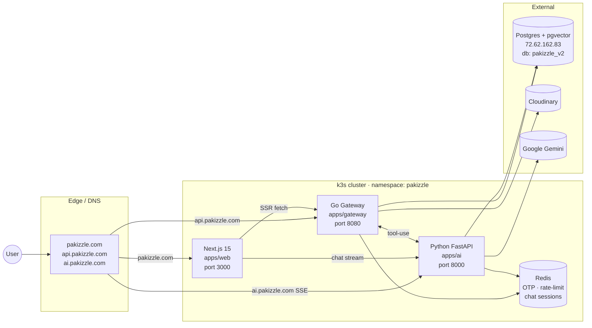

# Pakizzle v2 — Architecture

> v1 (Vite + Express monolith) lives at the repo root and remains untouched.
> v2 (Next.js + Go + Python) lives under `apps/` and is the target architecture.

## TL;DR



## Service responsibilities

### `apps/web` — Next.js 15 (App Router)
- Public website, marketplace, listing detail (SSR for SEO), sell flow, verification flow.
- User dashboard and admin dashboard (route-guarded).
- Chatbot drawer that streams from `apps/ai` via SSE.
- No business logic — every data fetch is a typed call into the Go gateway.
- Auth: JWT in an HttpOnly cookie set after `/api/auth/login`.

### `apps/gateway` — Go (chi + pgx)
- **Single Go service** today; can split into microservices later without changing the public contract.
- Owns all `/api/*` REST endpoints defined in `packages/proto/openapi.yaml`:
  - auth (register, login, me, email-magic-link)
  - otp (phone, email — 5 min TTL, Redis-backed)
  - verification (identity & business document upload → Cloudinary, AVIF conversion)
  - catalogue (makes / models / variants — admin CRUD)
  - listings (search + CRUD with full-text + structured filters)
  - admin (approval queue, approve/reject, audit log)
  - `/api/ai/*` reverse proxy for server-to-server AI calls
- Signs JWTs (HS256) used by all three services.
- Talks to **Postgres** for the source of truth, **Redis** for hot cache, **Cloudinary** for assets.

### `apps/ai` — Python FastAPI
- LLM-shaped concerns only. No CRUD.
- Endpoints:
  - `/ai/chat` — streaming Gemini chatbot with tool-use. Tools call back into the Go gateway with the user's JWT.
  - `/ai/valuation` — structured-output Gemini call grounded with comparable listings from the gateway.
  - `/ai/search` — natural-language → structured filters + pgvector semantic search.
- Persists chat sessions to Postgres (`chat_sessions`, `chat_messages` tables).
- Embeddings stored in pgvector (`listing_embeddings`).
- **Verifies** JWTs issued by the Go gateway (same `JWT_SECRET`); never issues them.

## Data model split

| Concern | Where | Why |
|---|---|---|
| users, listings, catalogue, verification, chat sessions | Postgres | Single source of truth, transactional |
| embeddings (vector(768)) | Postgres (pgvector) | One DB to operate, joins to listings free |
| OTP codes (5 min TTL) | Redis | Ephemeral, hot path |
| Rate-limit counters | Redis | High-frequency writes |
| API responses | Redis (read-through, future) | Catalogue & search caching |
| Listing photos, KYC docs | Cloudinary | CDN + transforms (AVIF/WebP) |

## Why this split

| Decision | Reason | Tradeoff |
|---|---|---|
| **Next.js 15** for web | SSR/RSC unlocks SEO on listing pages (huge for marketplaces). Server actions for forms. Built-in image optimization. | Heavier runtime than Vite SPA. |
| **Go** for the gateway | Cheap to scale horizontally (2 MB binary, fast cold start in k3s), strong typing, mature `pgx` driver. | More boilerplate than Node. |
| **Python** for AI only | LangChain / LlamaIndex / sentence-transformers / fine-tuning ecosystem is unmatched. Async FastAPI is fast enough for LLM-bound work. | Adds a third language. |
| **Single gateway** today | Optionality without ops cost. When `listings` becomes a hot spot we extract it; until then, one binary. | None — easy to split later. |
| **Shared `JWT_SECRET`** | Web sends a token issued by Go; Python verifies it without an extra round trip. | Must rotate everywhere together (Secret-rotation runbook needed). |
| **pgvector** instead of a dedicated vector DB | One DB to back up, one to monitor; joins from embeddings to listing rows for free. | Less scalable past ~10M embeddings (won't matter for years). |

## Local development

```bash
make dev          # full stack via docker compose (Postgres + Redis + 3 services)
make dev-infra    # only Postgres + Redis, then run services natively for fast reload:
make gateway      #   Go service via `air` hot reload
make ai           #   Python service via `uvicorn --reload`
make web          #   Next.js via `next dev`
```

## Production deploy

See [`k8s/README.md`](k8s/README.md). Summary:

```bash
# build & push (CI does this on tag)
make push-all TAG=v2.0.3

# roll the cluster
make k8s-rollout TAG=v2.0.3
```

## The v1 → v2 contract migration

The v1 monolith and v2 stack expose the **same** `/api/*` surface. While v2 is being
built and tested, the public DNS can point at either side. Mid-cutover, we can
even split: keep `/api/admin/*` on v1 (still in the React app) and shift only
`/api/listings`, `/api/makes/*` to v2.

## What is intentionally NOT in v2

- **Firebase** — Auth and Firestore are removed. JWT + Postgres is the new
  ground truth. Existing Firestore data (chat threads) will be exported into
  `chat_sessions` during cutover. See `firestore.rules` and
  `firebase-blueprint.json` for the legacy shape.
- **In-memory mock data** — v1's `users[]` array in `server.ts` is gone; v2
  is Postgres-only from day one.
- **OpenAI** — Gemini only.
