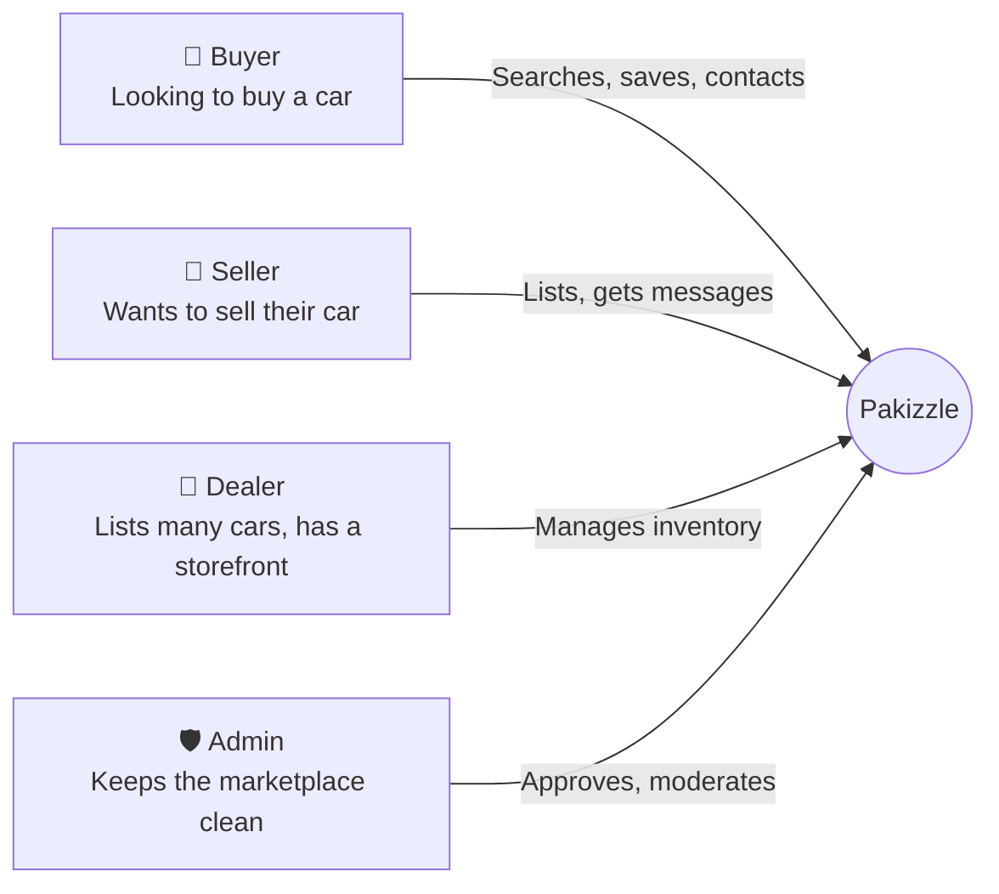
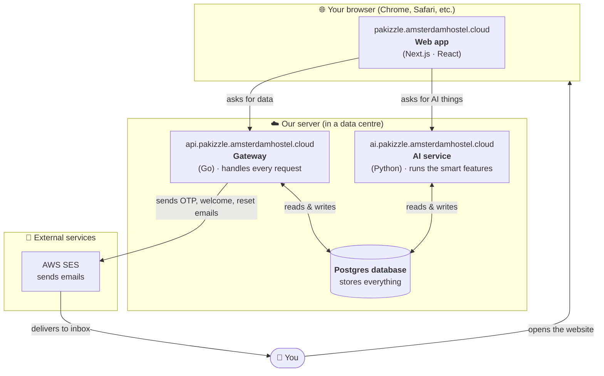
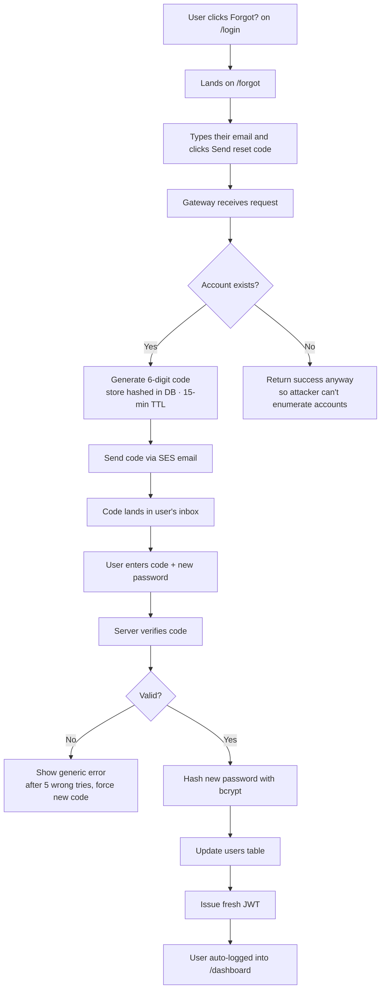
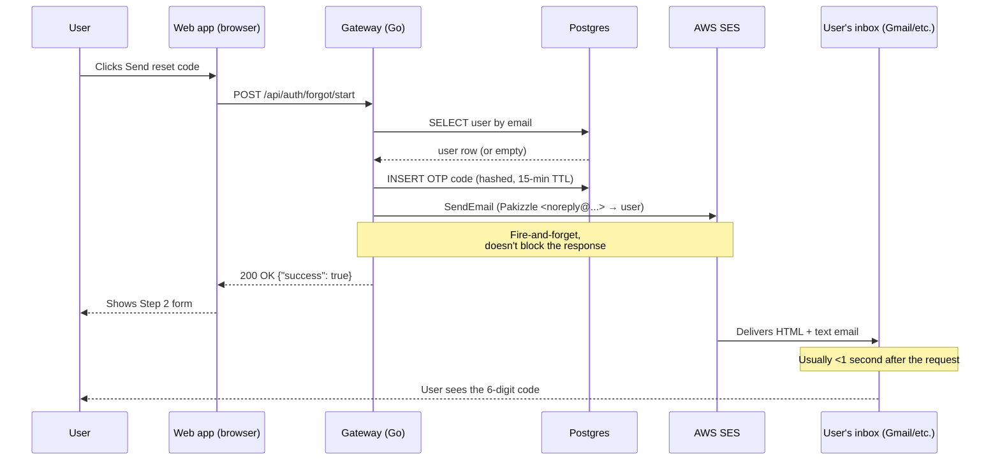
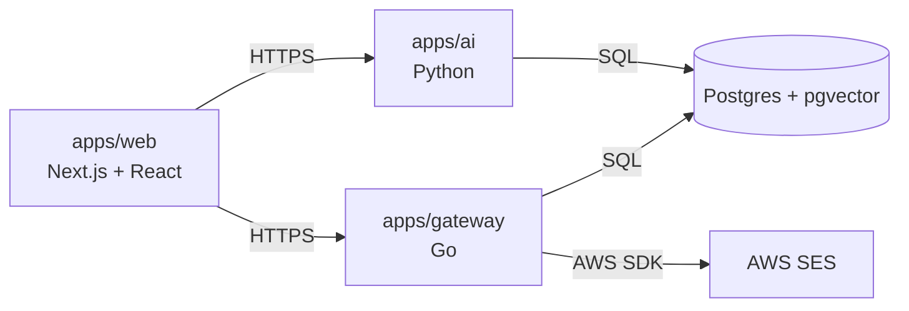
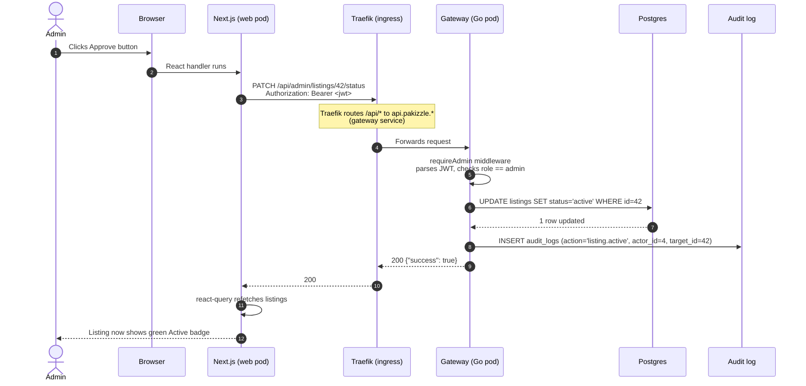

<div align="center">


# Pakizzle

**Pakistan's premium automotive marketplace** — find a car, list a car, book an inspection, get insurance, finance a loan, all in one place.

🌐 **Live site:** https://pakizzle.amsterdamhostel.cloud

</div>

---

## Table of Contents

**For everyone**
1. [What Pakizzle is — in 60 seconds](#1-what-pakizzle-is--in-60-seconds)
2. [Who uses it](#2-who-uses-it)
3. [What can you actually do?](#3-what-can-you-actually-do)
4. [How it all fits together (big picture)](#4-how-it-all-fits-together-big-picture)

**For everyone, with flowcharts**
5. [Buyer journey — browsing and buying a car](#5-buyer-journey)
6. [Seller journey — listing a car](#6-seller-journey)
7. [Admin journey — keeping the marketplace healthy](#7-admin-journey)
8. [Forgot-password journey](#8-forgot-password-journey)
9. [How an email actually leaves the system](#9-how-an-email-actually-leaves-the-system)

**For technical readers**
10. [The three apps (web, gateway, AI)](#10-the-three-apps)
11. [Where the data lives](#11-where-the-data-lives)
12. [Request lifecycle (single button-click traced through every layer)](#12-request-lifecycle)
13. [URL map](#13-url-map)
14. [API surface](#14-api-surface)
15. [Deploy pipeline (how a code change reaches the live site)](#15-deploy-pipeline)
16. [Run it locally](#16-run-it-locally)
17. [Environment variables](#17-environment-variables)
18. [Status board — what's done, what's coming](#18-status-board)
19. [Glossary](#19-glossary)
20. [Folder structure](#20-folder-structure)

---

## 1. What Pakizzle is — in 60 seconds

> **Pakizzle is to cars in Pakistan what Amazon is to physical goods.**
> Sellers post their vehicles. Buyers browse, save favourites, message sellers, and book a third-party inspection before they pay. The platform also helps buyers get insurance and a loan if they need one.

It's a **website** that runs in your browser (no app to install). Behind the scenes there's a small piece of software running on a server in the cloud that stores all the listings in a database and sends emails when needed.

---

## 2. Who uses it



| Role | What they get | Where they go |
|---|---|---|
| **Buyer** | Search 1000s of cars, save favourites, message sellers, get a valuation | `/marketplace` |
| **Seller** | List your car in 3 minutes, manage replies, see how many people viewed | `/dashboard` |
| **Dealer** | Same as seller but with a branded storefront and bulk-listing tools | `/dashboard` *(planned: `/dealer/[slug]`)* |
| **Admin** | Approve new listings, ban bad actors, edit homepage, see revenue | `/admin` |

---

## 3. What can you actually do?

A non-exhaustive but accurate menu of the buttons and what they do.

### As a buyer
- **Browse the marketplace** with filters for make, model, price, city
- **Open a listing** to see photos, specs, location, seller info
- **Save to wishlist** so you can come back to it
- **Get an AI valuation** — type a year + model and the AI tells you a fair price *(coming online)*
- **Book an inspection** — a third-party mechanic checks the car for you
- **Get an insurance quote** — compare premiums from EFU / Adamjee / Jubilee
- **Apply for financing** — auto-loan from HBL / Meezan / others
- **Message the seller** *(chat module shipping next)*

### As a seller
- **Sign up** with email + password (we email you a code to confirm)
- **Post an ad** — pick make/model/year, upload photos, set price
- **Wait for approval** — admin reviews and approves within minutes
- **Manage your listings** — edit, pause, mark as sold
- **See analytics** — total views, wishlist saves, message count
- **Get paid promotion** — pay a small fee to "Feature" your listing at the top

### As an admin
- **Approve / reject** new listings
- **Manage users** — promote moderators, ban bad accounts
- **Edit homepage banners** — change the hero rotator without a deploy
- **Manage categories** — add/remove the showcase tiles on the homepage
- **Curate vehicle data** — add a new car make, model, or trim
- **Run the inspection / insurance / financing CRMs** — change request status, contact customer
- **See live revenue** — dashboard tile shows month-to-date revenue
- **Check the audit log** — every admin action is logged

---

## 4. How it all fits together (big picture)

The simplest way to think about it: **3 apps + 1 database + 1 email service.** Everything else is plumbing.



### Plain-English version

| Layer | What it is | Real-world analogy |
|---|---|---|
| **Web app** | The pages you see and click | The shop floor where you walk around |
| **Gateway** | The brain that handles every request | The cashier — takes orders, looks them up, hands them back |
| **AI service** | A smart helper for valuations and chat | A consultant on call |
| **Database** | The warehouse that stores everything | A massive Excel sheet, organised |
| **Email service** | Sends emails on our behalf | Pakistan Post but instant |

---

## 5. Buyer journey

What happens from "I want a car" to "I bought a car".

```mermaid
flowchart TD
    Start([Buyer visits pakizzle.amsterdamhostel.cloud]) --> Home[See homepage with hero banner + featured cars]
    Home --> Browse{Pick an action}

    Browse -->|Browse marketplace| MP[Marketplace page<br/>see all active listings]
    MP --> Filter[Filter by make, model, price, city]
    Filter --> Click[Click a listing]
    Click --> Detail[Listing page<br/>photos · specs · seller info]

    Detail --> Auth{Signed in?}
    Auth -->|No| SignUp[Sign up or log in]
    SignUp --> Verify[We email a code,<br/>buyer types it in]
    Verify --> Detail

    Auth -->|Yes| Decide{What now?}

    Decide -->|Save for later| Wish[Heart icon → added to wishlist<br/>stored in their account]
    Decide -->|Contact seller| Chat[Message seller<br/>chat module shipping next]
    Decide -->|Want a price check| Val[AI Valuation modal<br/>type model + year]
    Decide -->|Want it inspected| Insp[Inspections page → fill request<br/>admin gets a ticket]
    Decide -->|Need insurance| Ins[Insurance page → quote form]
    Decide -->|Need a loan| Fin[Financing page → application]

    Wish --> Dash[/dashboard/wishlist shows it]
    Chat --> Done([Buyer + seller transact off-platform])
    Insp --> Admin{{Admin CRM picks it up}}
    Ins --> Admin
    Fin --> Admin
    Admin --> Reply[Customer hears back via email/phone]
    Reply --> Done
```

---

## 6. Seller journey

```mermaid
flowchart TD
    Start([Seller has a car to sell]) --> SignUp{Have an account?}
    SignUp -->|No| Register[Register with name, email, password]
    Register --> Welcome[We email a welcome message]
    Welcome --> Login

    SignUp -->|Yes| Login[Sign in at /login]
    Login --> Dash[/dashboard — Welcome screen]

    Dash --> List[Click List Vehicle]
    List --> Form[Fill the form:<br/>make, model, year, price, photos, city]
    Form --> Submit[Submit]
    Submit --> Status{Status = pending}

    Status -.->|Admin sees it in Approval Center| AdminReview[Admin reviews]
    AdminReview -->|Approve| Active[Status → active<br/>shown on marketplace]
    AdminReview -->|Reject| Rejected[Seller notified with reason<br/>can edit & resubmit]

    Active --> Watch[Seller watches:<br/>views, wishlist saves, messages]
    Watch --> Sold{Sold?}
    Sold -->|Yes| MarkSold[Mark as sold on dashboard]
    Sold -->|No| Boost[Optional: pay Rs 1,500 to feature for 7 days]
    Boost --> Top[Listing pinned to top]
    Top --> Watch
    MarkSold --> Done([Listing archived as sold])
```

---

## 7. Admin journey

What an admin sees and does after logging in.

```mermaid
flowchart TD
    Login[Admin logs in at /login] --> Check{Is role = admin?}
    Check -->|No| Home[Redirected to homepage]
    Check -->|Yes| Dash[/admin — Ecosystem Pulse dashboard]

    Dash --> Tiles[Sees live tiles:<br/>users · active listings · revenue · pending requests]

    Dash --> Nav[Left sidebar nav]
    Nav --> Approvals[Approval Center<br/>new listings to review]
    Nav --> Users[Users — promote, ban, change badge]
    Nav --> Listings[All listings — approve, reject, ban, delete]
    Nav --> Banners[Homepage banners — CRUD]
    Nav --> Cats[Showcase categories — CRUD]
    Nav --> VData[Vehicle data — add makes, models, variants]
    Nav --> Dealers[Dealer storefronts]
    Nav --> Insp[Inspection CRM]
    Nav --> Ins[Insurance CRM]
    Nav --> Fin[Financing CRM]
    Nav --> Pay[Payments ledger]
    Nav --> Rep[User reports — triage]
    Nav --> Content[Editable content pages]
    Nav --> Audit[Audit log — every admin action]
    Nav --> Sett[Settings — feature flags, hero copy]

    Approvals --> Decision{Approve or reject?}
    Decision -->|Approve| Live[Listing goes live]
    Decision -->|Reject| Notify[Seller notified with reason]

    Users -->|Edit| Promote[Change role to moderator or admin]
    Users -->|Ban| BannedUser[Account marked banned]

    Audit -.->|Receives every action above| Log[Forensic trail in DB]
```

---

## 8. Forgot-password journey

A standalone diagram because passwords are a common source of confusion.



---

## 9. How an email actually leaves the system

Every email — welcome, OTP, password reset — follows the same path.



---

## 10. The three apps

We have **three** independent services. Each can be developed and deployed separately.

### Web (`apps/web/`)
- **What it is:** the website you see at pakizzle.amsterdamhostel.cloud
- **Built with:** Next.js 15 + React 19 + Tailwind v4
- **Runs as:** Node.js process, served by Next.js
- **Talks to:** Gateway (for data) + AI service (for valuations)

### Gateway (`apps/gateway/`)
- **What it is:** the API server. Every "save", "fetch", "delete" the browser does goes through here.
- **Built with:** Go 1.25 + chi router + pgx (Postgres driver)
- **Runs as:** small static binary (~12 MB), compiled into a distroless container
- **Talks to:** Postgres directly, SES for email, AI service for some routes

### AI service (`apps/ai/`)
- **What it is:** Python service for the smart features (valuation, semantic search)
- **Built with:** FastAPI + (your-favourite-AI-SDK)
- **Runs as:** Uvicorn process
- **Talks to:** Postgres (with pgvector for embeddings)



---

## 11. Where the data lives

Single PostgreSQL database called **`pakizzle`**. Tables fall into 4 themes.

| Theme | Tables | What's in them |
|---|---|---|
| **People** | `users`, `profiles` | Accounts, name, city, bio, WhatsApp, role, badge, banned status |
| **Catalogue** | `car_makes`, `car_models`, `car_variants` | Toyota → Corolla → XLI 1.3 — the dropdowns you see on the sell form |
| **Listings** | `listings`, `wishlists` | Every ad ever posted + every "save" |
| **Content** | `banners`, `showcase_categories`, `news_articles`, `content_pages` | Stuff the admin edits to change the homepage and the privacy/terms pages |
| **Operations** | `payments`, `dealers`, `reports`, `audit_logs`, `admin_settings`, `custom_fields`, `auction_verifications` | Admin-only tables for revenue, dealer storefronts, user reports, audit trail |
| **Requests CRMs** | `inspection_requests`, `insurance_requests`, `financing_requests` | Customer-submitted requests for these three verticals |
| **System** | `otp_codes`, `notifications`, `pricing_plans` | Temporary 6-digit codes, in-app notifications, paid-promotion tiers |

> Migration files live in `apps/gateway/cmd/gateway/migrations/`. They run automatically every time the gateway starts. Adding a new file (e.g. `006_my_change.sql`) is the only step needed to evolve the schema.

---

## 12. Request lifecycle

What happens when you click "Approve" on a pending listing in the admin panel.



---

## 13. URL map

What pages exist and who can access them.

### Public (anyone can visit)
| URL | What's there |
|---|---|
| `/` | Homepage — hero banners, category tiles, featured news |
| `/marketplace` | Searchable listings grid |
| `/vehicle/[id]` | Single listing detail page |
| `/login` · `/register` · `/forgot` | Authentication |
| `/verify` · `/verify-email` | Identity / email verification |
| `/sell` | The sell-your-car flow |
| `/services` · `/pricing` · `/insurance` · `/financing` · `/inspection` · `/valuation` · `/chat` · `/auction-verification` | Marketing / landing pages for adjacent verticals |
| `/privacy` · `/terms` | Editable content pages |
| `/profile/[userId]` | Public seller profile |

### Customer dashboard (signed-in users)
| URL | What's there |
|---|---|
| `/dashboard` | Overview — stats tiles, quick actions |
| `/dashboard/ads` | My listings |
| `/dashboard/wishlist` | Saved vehicles |
| `/dashboard/messages` | Chat *(coming soon)* |
| `/dashboard/inspections` · `/insurance` · `/financing` | Customer-side CRM views *(coming soon)* |
| `/dashboard/analytics` | Per-account performance |
| `/dashboard/profile` | Edit name, city, bio, WhatsApp |
| `/dashboard/settings` | Account, security, notifications, privacy |

### Admin (signed-in admins only)
| URL | What's there |
|---|---|
| `/admin` | Ecosystem Pulse — main dashboard |
| `/admin/approvals` | Pending listings queue |
| `/admin/listings` · `/users` · `/dealers` | Big-table management |
| `/admin/banners` · `/categories` · `/content` · `/vehicle-data` · `/custom-fields` · `/pricing` | Content editors |
| `/admin/inspections` · `/insurance` · `/financing` · `/verifications` · `/chats` · `/reports` · `/payments` | Operational CRMs |
| `/admin/audit` | Forensic log of every admin action |
| `/admin/settings` | Key/value store for runtime config |

---

## 14. API surface

The gateway exposes a clean REST API under `https://api.pakizzle.amsterdamhostel.cloud`.

### Public endpoints
- `GET /healthz` — liveness probe
- `POST /api/auth/register` · `POST /api/auth/login` · `GET /api/auth/me`
- `POST /api/auth/forgot/start` · `POST /api/auth/forgot/reset`
- `POST /api/otp/email/send` · `POST /api/otp/email/verify`
- `GET /api/makes` · `/api/models?makeId=` · `/api/variants?modelId=`
- `GET /api/listings` · `GET /api/listings/{id}`
- `GET /api/banners` · `/api/showcase-categories` · `/api/news`

### Authenticated user endpoints (require bearer token)
- `GET /api/profile` · `PATCH /api/profile`
- `POST /api/listings`
- `GET /api/me/listings` · `/api/me/wishlist` · `/api/me/analytics` · `/api/me/notifications`
- `POST /api/me/wishlist` · `DELETE /api/me/wishlist/{id}`

### Admin-only endpoints (require role=admin)
- `GET /api/admin/stats`
- `GET·PATCH /api/admin/users[/{id}]`
- `GET·PATCH·DELETE /api/admin/listings[/{id}[/status]]`
- `GET·POST·PATCH·DELETE /api/admin/banners[/{id}]`
- `GET·POST·PATCH·DELETE /api/admin/showcase-categories[/{id}]`
- `GET·POST·PATCH·DELETE /api/admin/{makes,models,variants}[/{id}]`
- `GET /api/admin/{dealers,payments,reports,pricing-plans,custom-fields,auction-verifications,audit,content-pages}`
- `POST /api/admin/{content-pages,settings}`
- `GET·PATCH /api/admin/{inspections,insurance,financing}[/{id}]`

---

## 15. Deploy pipeline

How code becomes live.

```mermaid
flowchart TD
    Dev[Developer commits code locally] --> Push[git push origin main]
    Push --> GH[GitHub repo<br/>redspotsproduction-sudo/pakizzle]
    GH --> Manual[Operator runs locally:<br/>docker build<br/>docker save | sudo k3s ctr images import]
    Manual --> K3s[k3s cluster on this host]
    K3s --> Apply[kubectl apply -f k8s/]
    Apply --> Rollout[k3s rolling update<br/>old pods drained, new pods come online]
    Rollout --> Migrate[Gateway runs migrations 001-005<br/>on every boot · idempotent]
    Migrate --> Live[Live at pakizzle.amsterdamhostel.cloud]
```

### Why no CI/CD yet?
- Single-host k3s with image-import bypass (faster than push-to-registry + pull)
- GHCR PAT is read-only for this org
- CI workflow is on the roadmap (see [Status board](#18-status-board))

---

## 16. Run it locally

You need: Docker, Node 20+, Go 1.25 (only if you want to hack on the gateway), Python 3.11+ (only for AI service).

```bash
# 1. Clone
git clone https://github.com/redspotsproduction-sudo/pakizzle.git
cd pakizzle

# 2. Bring up the full stack
docker compose up --build

# Visit:
# Web        → http://localhost:3000
# Gateway    → http://localhost:8080
# AI service → http://localhost:8000
# Postgres   → localhost:5432  (user/pass: pakizzle / pakizzle_dev)
```

Faster iteration loops (run apps natively, leave infra in Docker):

```bash
# Just infra
docker compose up -d postgres redis

# Three separate terminals:
make gateway   # → :8080
make ai        # → :8000
make web       # → :3000
```

---

## 17. Environment variables

The only required ones for the gateway are `DATABASE_URL` and `JWT_SECRET`. Everything else has a sensible default. See [`k8s/01-secrets.example.yaml`](k8s/01-secrets.example.yaml) for the full list.

| Var | Default | What for |
|---|---|---|
| `DATABASE_URL` | *(required)* | Postgres connection string |
| `JWT_SECRET` | *(required)* | Signs the JWTs |
| `ADMIN_EMAIL` | `redspotsproduction@gmail.com` | Auto-promoted to role=admin on every boot |
| `AI_SERVICE_URL` | `http://localhost:8000` | Where the gateway reaches the AI service |
| `SES_FROM_EMAIL` | `Pakizzle <noreply@…>` | From address on outgoing email |
| `SES_REGION` | `us-east-1` | AWS region for SES |
| `CLOUDINARY_URL` | *(empty)* | Image upload (optional, fallback works without it) |
| `NEXT_PUBLIC_GATEWAY_URL` | `http://localhost:8080` | **Build-time** — baked into web bundle |
| `NEXT_PUBLIC_AI_URL` | `http://localhost:8000` | **Build-time** — baked into web bundle |

> ⚠️ The `NEXT_PUBLIC_*` vars must be passed to `docker build` as `--build-arg`, not at runtime — Next.js inlines them at build time. The Makefile handles this automatically (`make build-web`).

---

## 18. Status board

What's live, what's stubbed, what's coming.

| Area | Status |
|---|---|
| ✅ Auth (register, login, forgot password) | Done |
| ✅ Admin panel — 19 pages, all wired to real data | Done |
| ✅ Customer dashboard — 7 sections | Done |
| ✅ Listings — create, browse, search, approve workflow | Done |
| ✅ Demo data — every admin/customer surface has something to show | Done |
| ✅ Email — welcome, OTP, password reset via AWS SES | Done |
| 🟡 Inspection / Insurance / Financing — admin CRM works, customer submit-form coming next | Partial |
| 🟡 AI valuation — UI exists, backend stubbed | Partial |
| 🟡 Chat / Messaging — UI stubs, no service yet | Partial |
| 🟡 Cloudinary image upload — wired in v1, not yet ported | Partial |
| ⏳ End-to-end Playwright test suite + GitHub Actions CI | Planned |
| ⏳ Dealer storefront pages (`/dealer/[slug]`) | Planned |
| ⏳ Real-time notifications (WebSocket or SSE) | Planned |
| ⏳ Cron job for daily revenue rollups, expiring featured listings | Planned |

---

## 19. Glossary

For non-technical readers — every jargon word that appears above, in plain English.

| Term | Plain English |
|---|---|
| **API** | A way for two computers to talk. The website asks the gateway "what listings are there?" via an API. |
| **Backend** | The server-side part — what runs on our cloud machine. Users don't see it. |
| **Bcrypt** | A safe way to scramble a password so even we can't read it. |
| **Bearer token (JWT)** | A digital ID card the browser shows on every request to prove who you are. |
| **CI/CD** | Continuous Integration / Deployment — robots that test and ship code automatically. |
| **CRUD** | Create, Read, Update, Delete — the four things you can do with any record. |
| **Database** | A super-organised filing cabinet for data. |
| **Distroless** | A Docker image with only the bare minimum — no shell, no extras. Tiny and secure. |
| **Docker / container** | A way to package an app with everything it needs so it runs the same anywhere. |
| **Frontend** | The bit you see in the browser — buttons, pages, layouts. |
| **Gateway / API server** | The "brain" that handles requests between the website and the database. |
| **GHCR** | GitHub Container Registry — where Docker images can be stored. |
| **Idempotent** | A button that does the same thing whether you press it once or ten times. Safe to retry. |
| **Ingress** | The front door of the cluster — decides which incoming request goes to which app. |
| **JWT** | JSON Web Token — see "bearer token". |
| **k3s** | A lightweight version of Kubernetes for running on a single small server. |
| **Kubernetes** | The robot janitor that keeps the apps running, restarts them on crash, handles deploys. |
| **Migration** | A script that adds/changes tables in the database. We run them automatically on every boot. |
| **Monorepo** | One Git repo with multiple apps inside (`apps/web`, `apps/gateway`, `apps/ai`). |
| **OTP** | One-Time Password — a 6-digit code emailed to you to verify it's really you. |
| **PII** | Personally Identifiable Information — email, phone, address. We're careful what we log. |
| **Postgres / PostgreSQL** | Our database. Free, open-source, very reliable. |
| **Rolling update** | Replacing the running app one pod at a time so users never see downtime. |
| **SES** | AWS Simple Email Service — sends our emails. |
| **Traefik** | The piece of software that routes incoming requests to the right app. |

---

## 20. Folder structure

```
pakizzle/
├── apps/
│   ├── web/                    Next.js website (React 19, Tailwind v4)
│   │   ├── src/app/            Pages (Next.js App Router)
│   │   │   ├── admin/          Admin panel pages (19 of them)
│   │   │   ├── dashboard/      Customer dashboard pages
│   │   │   ├── forgot/         Forgot password
│   │   │   └── ...             Marketing pages
│   │   ├── src/components/     React components (admin, customer, ui)
│   │   ├── src/context/        Auth context
│   │   ├── src/lib/            API client, env, utils
│   │   └── Dockerfile
│   │
│   ├── gateway/                Go API server
│   │   ├── cmd/gateway/        Main + handlers (admin.go, customer.go, forgot.go…)
│   │   ├── cmd/gateway/migrations/  SQL files run on every boot
│   │   ├── internal/           Auth, config, db, logger
│   │   └── Dockerfile
│   │
│   └── ai/                     Python AI service
│       └── app/                FastAPI handlers
│
├── k8s/                        Kubernetes manifests for deploy
│   ├── 00-namespace.yaml
│   ├── 10-gateway.yaml
│   ├── 20-ai.yaml
│   ├── 30-web.yaml
│   ├── 40-ingress.yaml
│   ├── 50-redis.yaml
│   ├── 60-postgres.yaml
│   └── pakizzle-app-secrets.yaml   (gitignored)
│
├── src/                        Legacy v1 (Vite + Express + Firebase)
│                               Still in the repo but not deployed
│
├── docker-compose.yml          Full-stack local dev
├── Makefile                    `make web`, `make gateway`, `make build-all`, etc.
├── ARCHITECTURE.md             Deeper technical notes
└── README.md                   You are here
```

---

## License

Proprietary — © Redspots Production. All rights reserved.
